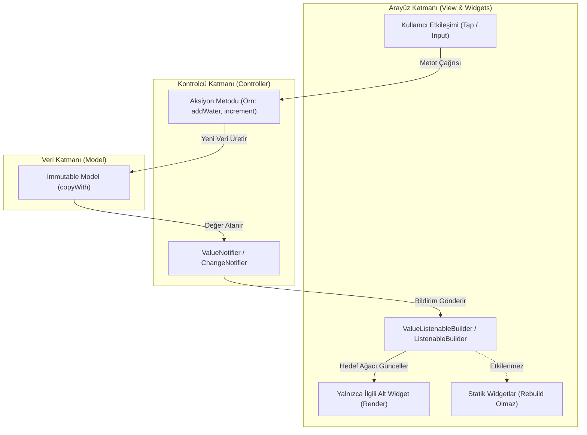

# State Yönetimi ve Mimari Akış Referansı (Clean UI & Reaktif State)

Bu doküman, Flutter projelerinde `project.md` ve `SKILL.md` kurallarına uygun olarak geliştirme yapan yazılımcılar ve yapay zeka ajanları için bağlayıcı bir durum yönetimi ve mimari akış kılavuzudur.

---

## 1. Mimari Katmanlar ve Sorumlulukların Ayrımı (Separation of Concerns)

Projede kodlar asla tek bir dosyada toplanmaz. Her özellik (feature) kendi izole dizini altında dört temel katmana ayrılır:

```text
lib/features/<feature_name>/
├── controllers/          # İş mantığı, durum tanımları ve reaktif yayıncılar
│   └── <feature>_controller.dart
├── models/               # İmmutable veri modelleri ve JSON serileştirme
│   └── <feature>_model.dart
├── view/                 # Ana sayfa iskeleti, yerleşim ve ValueListenableBuilder
│   └── <feature>_view.dart
└── widgets/              # 40 satırı geçmeyen, bağımsız ve yeniden kullanılabilir alt bileşenler
    └── <feature>_card.dart
```

### Katman Sorumluluk Tablosu:
| Katman | Sorumluluk | İzin Verilen | Kesinlikle Yasak |
| :--- | :--- | :--- | :--- |
| **Model** | Veri tanımı ve transferi | `immutable`, `const`, `copyWith`, `fromJson`, `toJson` | UI kodu, Controller bağımlılığı |
| **Controller** | İş mantığı ve reaktif durum | `ValueNotifier`, `ChangeNotifier`, hesaplama metotları | `BuildContext`, widget importu, UI çizimi |
| **View** | Sayfa iskeleti ve navigasyon | `StatelessWidget`, `ValueListenableBuilder`, Scaffold | Sayfa düzeyinde ağır `setState`, iş mantığı |
| **Widget** | Özel görsel bileşen | `const` constructor, tema dinamizmi, atomik UI | 40 satırı aşan build metodları |

---

## 2. Reaktif Durum Akış Diyagramı (State Flow)

Aşağıdaki şema, kullanıcı etkileşiminden arayüzün güncellenmesine kadar olan reaktif döngüyü göstermektedir:



---

## 3. Temel Durum Yönetimi Kuralları ve Prensipler

### 1. Sayfa Düzeyinde Devasa `setState` Yasağı
* **Neden:** `StatefulWidget` içerisinde sayfa seviyesinde çağrılan her `setState`, tüm sayfa ağacını, appbar'ı ve statik bileşenleri baştan aşağı yeniden oluşturur (rebuild). Bu durum CPU yükü, pil tüketimi ve animasyonlarda takılmalara (jank) neden olur.
* **Standart:** Yalnızca lokal arayüz durumu gerektiren küçük bileşenlerde (örn. sayfa içi geçici tab seçimi) `StatefulWidget` kabul edilir. Ekran veri durumu daima `ValueNotifier` veya `ChangeNotifier` ile dinlenir.

### 2. `ValueNotifier` ile Hafif Reaktivite
* Tekil ilkel değerler (`int`, `double`, `bool`, `String`) veya tek bir veri listesi için `ValueNotifier<T>` tercih edilir.
* Arayüzde dinleme yapılırken:
```dart
ValueListenableBuilder<int>(
  valueListenable: controller.currentWater,
  builder: (context, currentWater, child) {
    return Text('$currentWater ml');
  },
)
```

### 3. Yaşam Döngüsü ve `dispose()` Zorunluluğu
* Açılan her `ValueNotifier` ve `ChangeNotifier`, controller sonlandığında mutlaka bellekten temizlenmelidir. Temizlenmeyen notifier'lar arka planda dinleyici tutarak **Memory Leak** (Bellek Sızıntısı) oluşturur.
```dart
void dispose() {
  currentWater.dispose();
  timerNotifier.dispose();
}
```

### 4. Build Metotlarının 40 Satır Kuralı
* Bir widget'ın `build` metodu 40 satırı geçtiği anda, ilgili görsel bölüm `_buildHeader()`, `_buildCardList()` gibi yardımcı metotlara veya bağımsız `StatelessWidget` sınıflarına bölünmelidir.
* Bağımsız widget sınıflarına bölmek Flutter'ın `const` optimizasyonundan maksimum düzeyde yararlanmasını sağlar.

---

## 4. Tema ve Dinamik Renk Entegrasyonu

Widget'lar içine doğrudan koyu renk sabitleri (örn. `Color(0xFF090D16)`) kodlanamaz:
* Renkler ve metin stilleri daima tema ve extension'lar üzerinden alınır:
```dart
final theme = Theme.of(context);
final cardColor = context.cardColor;
final textColor = context.textPrimaryColor;
```
* Bu sayede uygulama tek tıkla Aydınlık (Light) ve Karanlık (Dark) modlar arasında geçerken arayüz kodunda hiçbir if/else koşulu gerekmeden anında adapte olur.

---

## 5. Doğrulama ve Test Standartları

Durum yönetimindeki herhangi bir değişiklikten sonra şu adımlar doğrulanmalıdır:
1. **Controller Birim Testleri:** UI'dan bağımsız olarak `controller.action()` çağrıldığında `notifier.value` değerinin beklenen çıktıyı ürettiği test edilmelidir.
2. **Statik Kod Analizi:**
```bash
flutter analyze
```
*0 hata ve 0 uyarı şarttır.*
3. **Widget Testleri:**
```bash
flutter test
```
*ValueListenableBuilder'ın tetiklenmesiyle arayüzün güncellendiği doğrulanmalıdır.*
