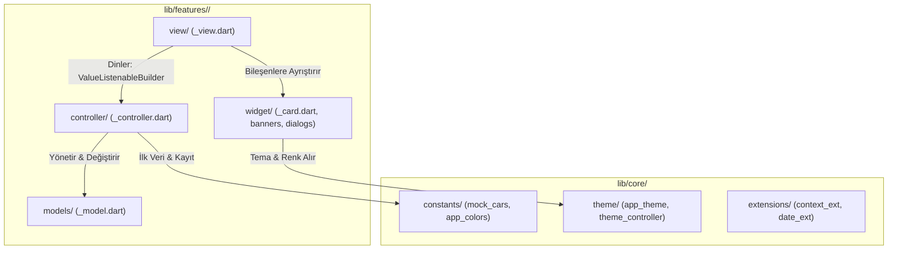
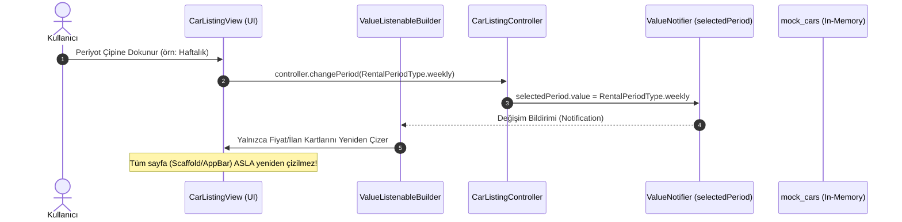
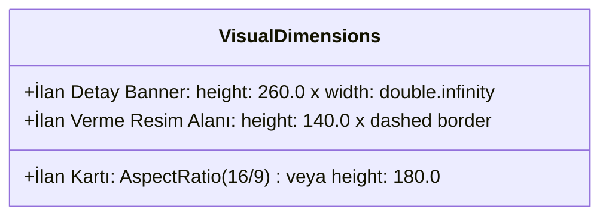
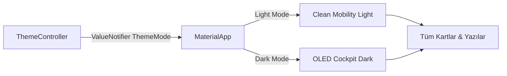
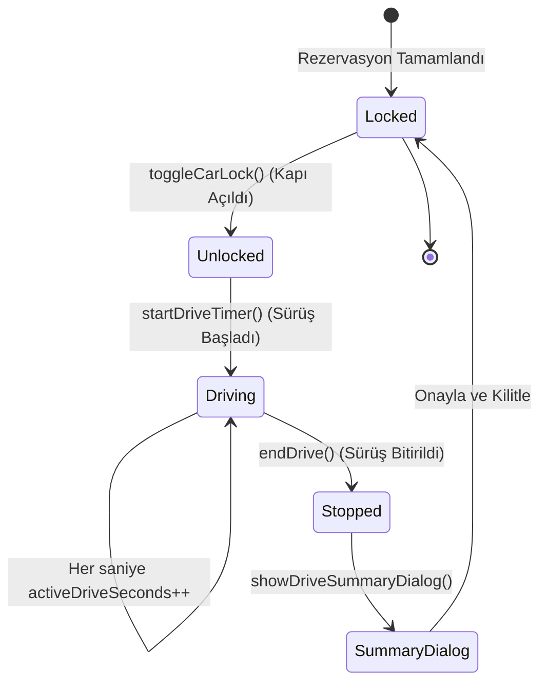

# TakeGO - Reaktif Durum Akışı, Mimari ve Standartlar Referansı (`state_flow.md`)

Bu doküman, **TakeGO** platformunda geliştirme yapacak yapay zeka ajanları ve geliştiriciler için mimari katmanları, durum yönetimini (`ValueNotifier`), tema entegrasyonunu ve sabit görsel hiyerarşisini detaylandıran bağlayıcı referanstır.

---

## 1. Mimari Katmanlar ve Sorumluluk Dağılımı

TakeGO, **Özellik Bazlı (Feature-First)** ve **Clean Architecture** prensiplerine uygun olarak 4 temel katmana ayrılır:



### Katman Sorumlulukları

| Katman | Dosya Yolu | Sorumluluk | Yasaklar |
|---|---|---|---|
| **Model** | `models/<feature>_model.dart` | `@immutable` veri sınıfı, `copyWith`, `fromJson`, `toJson`. | İş mantığı ve Flutter UI importları barındırmaz. |
| **Controller** | `controller/<feature>_controller.dart` | `ValueNotifier` durumları, filtreleme, hesaplama, `dispose`. | `BuildContext` veya doğrudan widget kodu içermez. |
| **View** | `view/<feature>_view.dart` | `StatelessWidget`, sayfa iskeleti (`Scaffold`), `ValueListenableBuilder`. | Ağır `setState`, 40 satırı aşan `build` metotları. |
| **Widget** | `widget/<feature>_*.dart` | Atomik UI bileşenleri, sabit resim kutuları, rozetler, butonlar. | Doğrudan global state manipülasyonu yapmaz; parametre ve callback alır. |

---

## 2. Reaktif Durum Akışı (ValueNotifier Lifecycle)

TakeGO projesinde harici ağır paketler (`Bloc`, `Riverpod`, `GetX`) yerine Flutter çekirdeğinde yer alan **`ValueNotifier`** ve **`ValueListenableBuilder`** kullanılır.

### Tek Yönlü Veri Akışı (Unidirectional Data Flow)



### Kodlama Standardı ve Yaşam Döngüsü (Lifecycle)

```dart
// 1. Controller Tanımı
class CarListingController {
  final ValueNotifier<RentalPeriodType> selectedPeriod =
      ValueNotifier<RentalPeriodType>(RentalPeriodType.daily);

  final ValueNotifier<List<CarModel>> carsNotifier =
      ValueNotifier<List<CarModel>>(List.unmodifiable(mockCars));

  void changePeriod(RentalPeriodType period) {
    if (selectedPeriod.value != period) {
      selectedPeriod.value = period;
    }
  }

  void addNewListing(CarModel car) {
    // Liste referansı değişmeli ki ValueNotifier tetiklensin:
    carsNotifier.value = [car, ...carsNotifier.value];
  }

  void dispose() {
    selectedPeriod.dispose();
    carsNotifier.dispose();
  }
}

// 2. View Katmanında Dinleme
class CarListingView extends StatelessWidget {
  final CarListingController controller;
  const CarListingView({super.key, required this.controller});

  @override
  Widget build(BuildContext context) {
    return Scaffold(
      appBar: AppBar(title: const Text('TakeGO İlanlar')),
      body: Column(
        children: [
          // Sadece periyot seçici yeniden çizilir:
          ValueListenableBuilder<RentalPeriodType>(
            valueListenable: controller.selectedPeriod,
            builder: (context, period, _) {
              return PeriodFilterChips(
                currentPeriod: period,
                onSelected: controller.changePeriod,
              );
            },
          ),
          // Sadece liste içeriği yeniden çizilir:
          Expanded(
            child: ValueListenableBuilder<List<CarModel>>(
              valueListenable: controller.carsNotifier,
              builder: (context, cars, _) {
                return ListView.builder(
                  itemCount: cars.length,
                  itemBuilder: (ctx, i) => CarCardWidget(car: cars[i]),
                );
              },
            ),
          ),
        ],
      ),
    );
  }
}
```

---

## 3. Sabit Görsel Geometrisi ve Taşma Önleme Standardı

Gerçek araç fotoğrafları dinamik URL'lerden geleceği ya da ağ hatası nedeniyle yüklenemeyeceği için, arayüzün kaymasını veya `RenderFlex overflowed by ... pixels` hatasını önlemek adına **3 sabit görsel alanı** tanımlanmıştır:



### Görsel Kural Tablosu

| Ekran / Bileşen | Dosya | Sabit Boyut Kuralı | Fallback (Yedek) Davranışı |
|---|---|---|---|
| **İlan Kartı** | `car_card_widget.dart` | `AspectRatio(aspectRatio: 16 / 9)` veya `height: 180.0` | Temaya uygun `surfaceContainerHighest` rengi, ortalanmış araç ikonu/silüeti. |
| **İlan Detayı** | `car_image_banner.dart` | `height: 260.0`, `width: double.infinity` | `BoxFit.cover`, yükleme göstergesi ve hata anında metalik kokpit silüeti. |
| **İlan Verme** | `image_upload_placeholder.dart` | `height: 140.0`, `width: double.infinity` | Kesikli sınır (dashed border), kamera ikonu, "Fotoğraf Ekle" metni. |

---

## 4. Tema ve Renk Akışı (Cyber Drive Paleti)

Uygulama genelinde sabit `Color(0xFF...)` kullanımı **kesinlikle yasaktır**. Bütün renkler `Theme.of(context).colorScheme` ve `AppColors` üzerinden çözümlenir:



### Renk Eşleşme Tablosu

| Anlamsal Rol | Gündüz (Clean Mobility) | Gece (OLED Cockpit) | Flutter ColorScheme Karşılığı |
|---|---|---|---|
| **Arka Plan** | `#F6F8FA` | `#0B0E14` | `colorScheme.surface` / `scaffoldBackgroundColor` |
| **Kart Yüzeyi** | `#FFFFFF` | `#161B26` | `colorScheme.surfaceContainer` |
| **Ana Vurgu (Elektrik)** | `#0066FF` | `#2F80ED` | `colorScheme.primary` |
| **İkincil Vurgu (Yeşil)** | `#00D084` | `#10B981` | `colorScheme.secondary` |
| **Metin - Birincil** | `#111827` | `#F9FAFB` | `colorScheme.onSurface` |
| **Metin - İkincil** | `#6B7280` | `#9CA3AF` | `colorScheme.onSurfaceVariant` |
| **Çerçeve / Çizgi** | `#E5E7EB` | `#242C3D` | `colorScheme.outlineVariant` |
| **Resim Dolgusu** | `#E2E8F0` | `#1F2937` | `colorScheme.surfaceContainerHighest` |

---

## 5. Dijital Anahtar ve Canlı Sürüş Asistanı Yaşam Döngüsü

TakeGO'nun fark yaratan özelliği olan dijital anahtar ve asistan akışı şu adımlarla çalışır:



### Kontrolcü Durum Değişkenleri:
- `isCarUnlocked = ValueNotifier<bool>(false)`
- `activeDriveSeconds = ValueNotifier<int>(0)`
- `isHeadlightsOn = ValueNotifier<bool>(false)`
- `isTrunkOpen = ValueNotifier<bool>(false)`

---

## 6. Sık Yapılan Hatalar ve Anti-Pattern'ler

1. ❌ **Hata:** Sayfa gövdesini devasa `StatefulWidget` yapıp her tıklamada `setState((){})` çağırmak.
   - ✅ **Çözüm:** `StatelessWidget` kullan, yalnızca ilgili alanı `ValueListenableBuilder` ile sar.
2. ❌ **Hata:** Araç fotoğrafına sabit yükseklik vermemek (`Image.network(url)`).
   - ✅ **Çözüm:** Mutlaka `AspectRatio(16/9)` veya `height: 180` içine alıp `BoxFit.cover` ve placeholder tanımla.
3. ❌ **Hata:** `controller.dispose()` çağrısını unutmak veya controller içinde `BuildContext` saklamak.
   - ✅ **Çözüm:** Controller saf Dart nesnesidir. Sayfa kapandığında `dispose()` edilir.
4. ❌ **Hata:** Renkleri doğrudan hex koduyla widget içine gömmek (`color: Color(0xFF0066FF)`).
   - ✅ **Çözüm:** `color: Theme.of(context).colorScheme.primary` kullan.
