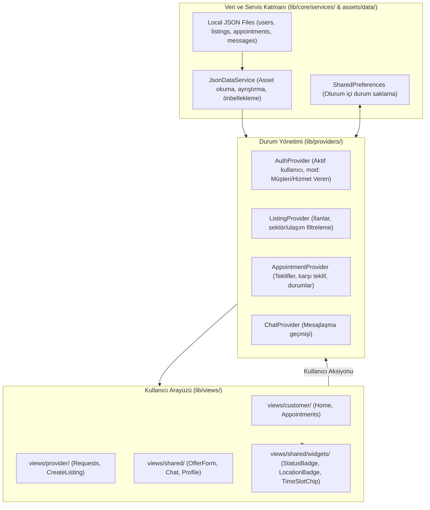
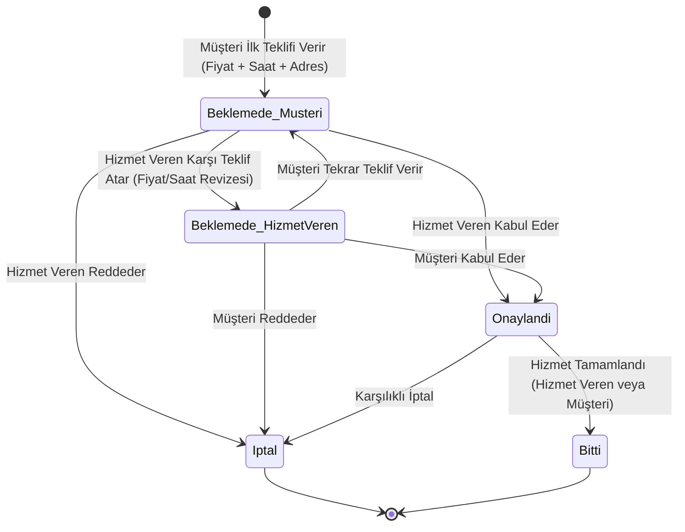
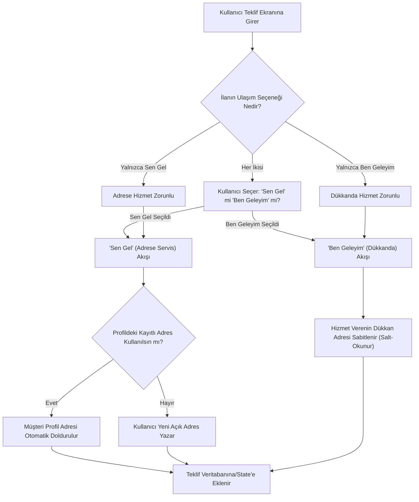
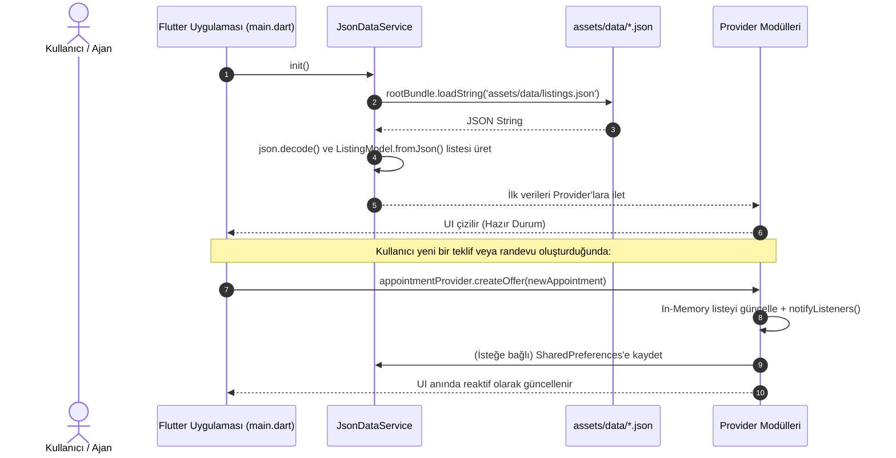

# Randevu Sistemi - Reaktif Durum Akışı ve Mimari Standartlar (`state_flow.md`)

Bu doküman, **Çok Sektörlü Teklif Usulü Randevu ve Hizmet Platformu** projesinde geliştirme yapacak yapay zeka ajanları ve geliştiriciler için durum yönetimi (`Provider` / `ChangeNotifier`), teklif-pazarlık döngüsü, konum-adres akışı ve yerel JSON senkronizasyonu için bağlayıcı referanstır.

---

## 1. Mimari Katmanlar ve Sorumluluk Dağılımı

Uygulama katmanlı ve modüler bir mimariye sahiptir:

### Katman Kuralları ve Yasaklar

| Katman | Sorumluluk | İzin Verilenler | Kesinlikle Yasak Olanlar |
| :--- | :--- | :--- | :--- |
| **Models** (`lib/models/`) | Saf veri transfer sınıfları. | `@immutable`, `copyWith`, `fromJson`, `toJson`. | UI widget kodları, `BuildContext`, iş mantığı. |
| **Services** (`lib/core/services/`) | `rootBundle` ile JSON yükleme, simüle gecikmeler. | `rootBundle.loadString`, `json.decode`, `SharedPreferences`. | `BuildContext`, doğrudan widget çizimi. |
| **Providers** (`lib/providers/`) | Durum değişiklikleri, iş akışı mantığı, teklif kuralları. | `ChangeNotifier`, `notifyListeners()`. | UI widget'ları, doğrudan layout kodları. |
| **Views** (`lib/views/`) | Sayfa düzenleri, `Scaffold`, `Consumer` / `Provider.of`. | `StatelessWidget`, hafif `StatefulWidget` (yalnızca local UI state). | Ağır iş hesaplamaları, JSON dosyalarını doğrudan okumak. |
| **Widgets** (`lib/views/shared/widgets/`) | Atomik ve yeniden kullanılabilir UI bileşenleri. | Parametre alma, `Theme.of(context)` kullanma, callbackler. | Global provider durumunu doğrudan kirletmek. |

---

## 2. Randevu ve Karşı Teklif Durum Makinesi (Offer Lifecycle)

Platformun kalbi olan çift taraflı teklif usulü akış şeması:

### Durum Alanları (`AppointmentModel`)
- `status`: `'beklemede'` | `'onaylandi'` | `'iptal'` | `'bitti'`
- `lastOfferBy`: `'customer'` | `'provider'`
  - Eğer `status == 'beklemede'` ve `lastOfferBy == 'customer'` ise: Hizmet Verenin onaylama veya karşı teklif verme sırasıdır.
  - Eğer `status == 'beklemede'` ve `lastOfferBy == 'provider'` ise: Müşterinin onaylama veya tekrar teklif verme sırasıdır.

---

## 3. Akıllı Konum ve Adres Yönetimi Akışı

Ulaşım tercihine göre adresin belirlenme mantığı:

---

## 4. Dolu ve Boş Saat Dilimi Yönetimi

Randevu çakışmalarını önlemek için:

1. Hizmet verenin `ListingModel` içerisinde tanımlı günlük çalışma saatleri vardır (örn: `["09:00", "10:30", "13:00", "14:30", "16:00"]`).
2. `AppointmentProvider` içindeki aktif randevulardan ilgili gün için `status == 'onaylandi'` olanlar bulunur.
3. Ekranda `TimeSlotChip` çizilirken:
   - Eğer saat dilimi onaylı bir randevuda kullanılıyorsa `isBooked: true` yapılır. Tıklanamaz ve üzeri çizgili gösterilir.
   - Boş saat dilimleri seçilebilir durumdadır (`isSelected: selectedTime == time`).

---

## 5. Offline-First JSON Senkronizasyon Yaşam Döngüsü

---

## 6. Anti-Pattern Rehberi (Yapılmaması Gerekenler)

- ❌ **Yanlış:** Teklif formunda doğrudan `setState` ile tüm ekranı baştan çizdirmek.
  - ✅ **Doğru:** Form alanlarını `Form` / `TextEditingController` ile yönetmek, liste ve seçimleri `Consumer` ile izole dinlemek.
- ❌ **Yanlış:** `sen_gel` konum tipinde hizmet verenin dükkan adresini müşteri adresi olarak kaydetmek.
  - ✅ **Doğru:** `sen_gel` seçildiğinde açıkça müşterinin girdiği veya profilinden çektiği ikamet/iş adresi kaydedilmelidir.
- ❌ **Yanlış:** İptal edilen (`iptal`) randevuların saat dilimini takvimde kilitli (`isBooked: true`) bırakmak.
  - ✅ **Doğru:** Yalnızca `onaylandi` statüsündeki randevular saat bloklar; iptal edilen veya reddedilen randevuların saati tekrar boşa çıkar.
- ❌ **Yanlış:** 500 satırlık devasa tek bir dosya yazmak.
  - ✅ **Doğru:** Kartlar, çipler ve diyaloglar `views/shared/widgets/` altında parçalanmalıdır.
