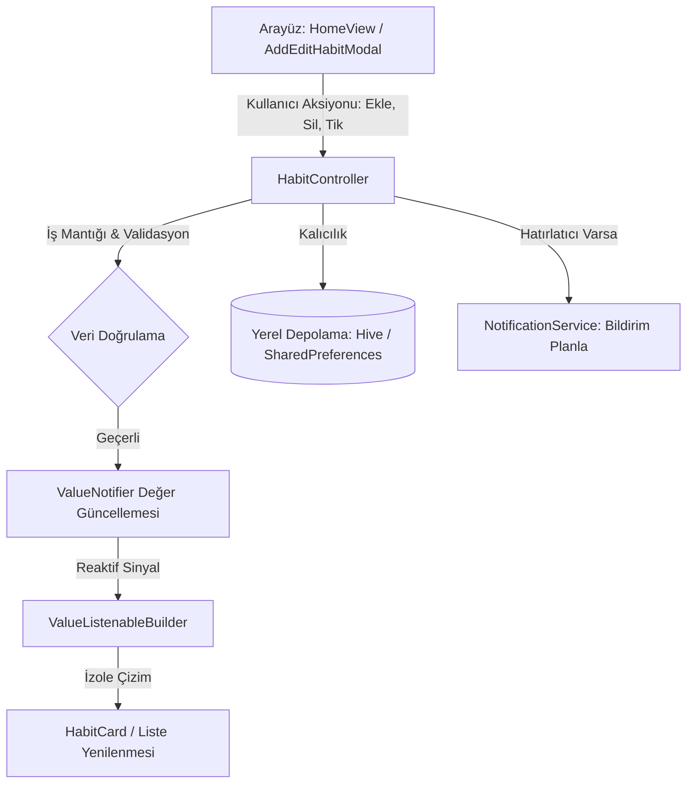

# Durum Yönetimi ve Veri Akış Referansı (references/state_flow.md)

Bu referans dokümanı; alışkanlık takip projesinde uygulanan **ValueNotifier Tabanlı Reaktif Durum Yönetimi (State Architecture)** kurallarını, veri akış zincirlerini ve bileşenler arası haberleşme standartlarını açıklar.

---

## 1. Mimari Felsefe: Neden ValueNotifier?

1. **İzole Yeniden Çizim (Targeted Re-render):** `setState()` tüm ekran ağacını (`build` metodunu) baştan sona yeniden tetiklerken; `ValueNotifier<T>` ve `ValueListenableBuilder<T>` yalnızca değişen değeri dinleyen spesifik widget düğümünü günceller.
2. **Sıfır Dış Bağımlılık:** Harici ağır durum paketlerine (BLoC, MobX vb.) gerek kalmadan, Flutter'ın temel çekirdek SDK'sı ile yüksek FPS ve minimum RAM tüketimi sağlar.
3. **Kolay Test Edilebilirlik:** Controller sınıfları `BuildContext`'e ihtiyaç duymadığından birim testleri (Unit Tests) saniyeler içinde saf Dart nesneleriyle çalıştırılabilir.

---

## 2. Temel Durum Akış Diyagramı (State Flow)



---

## 3. Alışkanlık Ekleme, Düzenleme ve Silme Akışları

### 3.1. Alışkanlık Ekleme Akışı (Create Habit Flow)
1. **Tetikleme:** Kullanıcı Sayfa 1'deki `FloatingActionButton`'a basar.
2. **Modal Açılışı:** `showModalBottomSheet(isScrollControlled: true)` ile `AddEditHabitModal` açılır.
3. **Form Girdileri:**
   - İsim girilir (`TextFormField`).
   - `assets/icons/` ikon ızgarasından görsel ikon seçilir.
   - Kategori seçilir (4 Temel Kategori: **Spor**, **Sağlık**, **Zihin**, **Müzik** veya `+ Kategori Ekle` ile yeni oluşturulan).
   - Haftalık günler seçilir (Pzt, Sal, Çar, Per, Cum, Cmt, Paz).
   - Zaman aralığı belirlenir (`showTimePicker` ile örn: `09:45 - 15:36`).
   - Hatırlatıcı açık/kapalı anahtarı (`SwitchListTile`) ayarlanır.
4. **Validasyon:** Form onaylanır; `_formKey.currentState!.validate()` geçerse yeni bir `HabitModel` oluşturulur.
5. **Controller İletimi:** `_habitController.addHabit(habit)` çağrılır.
6. **Notifier Güncellemesi:** `habitsNotifier.value = [...habitsNotifier.value, habit]`.
7. **Kalıcılık & Bildirim:** Veri yerel hafızaya yazılır, `hasReminder == true` ise bildirim servisi planlanır.

### 3.2. Alışkanlık Silme Akışı (Delete Habit Flow)
1. **Swipe to Delete (Sola Kaydırma):** `HabitCard` içindeki `Dismissible` bileşeni sola çekilir.
2. **Onay Penceresi (Confirm Dismiss):** `confirmDismiss` callback'i tetiklenerek `AlertDialog` açılır:
   *"Bu alışkanlığı silmek istediğinize emin misiniz? Zincir geçmişi kaybolacaktır."*
3. **Kullanıcı Kararı:**
   - **Vazgeç:** `Navigator.pop(ctx, false)` -> Kart eski konumuna yaylanarak döner (`Curves.easeOut`).
   - **Sil:** `Navigator.pop(ctx, true)` -> `_habitController.deleteHabit(habit.id)` çalıştırılır.
4. **Notifier Güncellemesi:**
   ```dart
   habitsNotifier.value = habitsNotifier.value.where((h) => h.id != id).toList();
   ```
5. **Liste Yenileme:** İlgili kart animasyonla yok olur; günlük ilerleme çubuğu (`ratio = completed / habits.length`) anında yeniden hesaplanır.

---

## 4. Kategori Durum Akışı (Category State Flow)

1. **Varsayılan 4 Kategori:**
   - `CategoryModel.defaultCategories`: Spor (`0xFF10B981`), Sağlık (`0xFF0EA5E9`), Zihin (`0xFF8B5CF6`), Müzik (`0xFFEC4899`).
2. **Kullanıcı Tarafından Yeni Kategori Ekleme:**
   ```dart
   void addCategory(CategoryModel newCategory) {
     categoriesNotifier.value = [...categoriesNotifier.value, newCategory];
     // Yerel depolamaya kaydet
   }
   ```
3. **Filtreleme Mantığı:**
   - `selectedCategoryNotifier.value = categoryId;`
   - UI üzerinde `habits.where((h) => selectedCategory == 'all' || h.categoryId == selectedCategory).toList();` ile anlık listeleme.

---

## 5. Yaşam Döngüsü (Lifecycle) Kuralları

- **Controller Başlatma:** Controller örnekleri ilgili `StatefulWidget`'ın `initState()` bloğunda oluşturulmalı, veriler burada yüklenmelidir (`loadDailyHabits()`).
- **Bellek Temizliği (Dispose):** Sayfa kapandığında bellek sızıntısını (Memory Leak) önlemek için Controller içindeki tüm `ValueNotifier` nesneleri `dispose()` edilmelidir:
  ```dart
  @override
  void dispose() {
    _habitController.dispose();
    super.dispose();
  }
  ```
- **Saf Build Metodu:** `build()` içinde asla controller başlatılmamalı, doğrudan hesaplama veya API/Storage çağrısı yapılmamalıdır.
